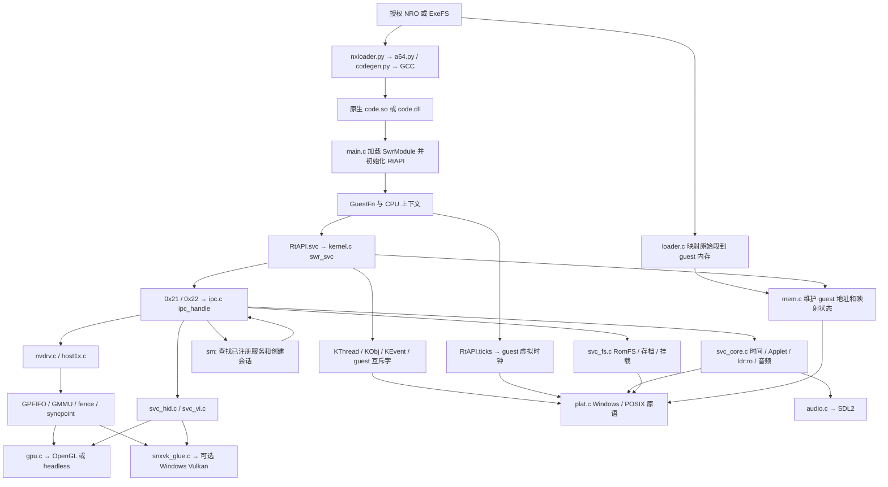

# Native Horizon Adapter Phase 0 架构审计

审计基线为 `main` 的 `713c8618689afb26b904673a0f2f9901eb6baf7b`。范围涵盖启动、模块 ABI、SVC、IPC、平台原语、服务依赖、构建入口和仓库内许可资料。接口名和行为以当前源码为证据，Horizon 的完整行为和授权状态仍须逐条验证。[多阶段开发计划](2026-11-18-native-horizon-adapter.md)

Phase 4 的复跑结果与待覆盖项见 [Runtime 集成与回归](../../nha/phase4.md)。

制品实测、许可复核和放行状态见 [Phase 5 发布前审计](../../nha/phase5.md)。

## 构建与覆盖范围

| 目标 | 仓库构建入口 | 关键差异 |
| --- | --- | --- |
| Linux x11 | `python3 switchrecomp.py --build-runtime --target linux --backend x11 --cc gcc` | `backend_x11.c`、GL、X11、pthread、dl |
| Linux headless | `python3 switchrecomp.py --build-runtime --target linux --backend headless --cc gcc` | `backend_headless.c`、`gpu_nogl.c`、pthread、dl |
| Windows win32 | `python3 switchrecomp.py --build-runtime --target win64 --backend win32 --cc x86_64-w64-mingw32-gcc` | `backend_win32.c`、GL、Win32 录制。存在 `libsnxvk.a` 且未设置 `SWR_NO_SNXVK` 时静态链接可选 Vulkan 后端 |
| Windows headless | `python3 switchrecomp.py --build-runtime --target win64 --backend headless --cc x86_64-w64-mingw32-gcc` | `backend_headless.c`、`gpu_nogl.c`、Windows 控制台入口 |

`build_runtime.bat` 调用同一个 Python 入口。Linux Runtime 当前显式使用 `-std=gnu17`，新增 C 代码按开发指南使用 C99 和允许的 GNU 扩展，沿用现有构建方言。GUI 有单独的构建脚本。可选静态库由文件是否存在决定，制品清单须依据实际链接结果。文档要求发布版本标识为 `v190`，当前源码在无宏覆盖时为 `v190 test`，应在发布前按项目惯例核对。[构建入口](../../../switchrecomp.py#L261) · [开发指南](../../../DEVELOPER_GUIDE.md#L45) · [版本宏](../../../runtime/main.c#L9) · [回归清单](../../../REGRESSION.md#L16)

本次宿主是 Darwin arm64，`gcc` 指向 Apple Clang。未找到目标 MinGW 编译器和 Xvfb，Docker CLI 已安装但 daemon 不可连接。已验证 CLI 帮助正常退出，以及现有 `tests/test_record_time.c` 在宿主上用 ASan/UBSan 独立执行通过。四个目标 Runtime、GPU 基线、完整音频用例和 Windows 真机均未执行。仓库含回归脚本，`tests/regress/programs/` 的 GPU 样本需重建。回归执行要单独验证样本存在和结果数，避免空集被当作通过。[回归说明](../../../REGRESSION.md#L37) · [GPU 脚本](../../../tests/regress/regrun.sh#L8)

## Horizon 组件与调用链

1. **重编译与引导。** `nxloader.load_program` 读取 NRO 或 ExeFS，解码和分析后由 `gen_module` 发出函数、入口地址表、`SwrModule` 元数据和已有解释器后备。`link_module` 生成原生 `.so` 或 `.dll`。`swr_main` 优先接受弱符号 `swr_module_static`，常见路径用 `plat_dl_open` 和 `swr_module` 加载同名模块，再检查 ABI、初始化 guest 内存和回调表、加载原始段、注册服务并启动 guest 主线程。`loader.c` 检查模块 build ID，延迟 NRO 由 `ldr:ro` 路径处理。[生成器](../../../switchrecomp.py#L97) · [命令入口](../../../switchrecomp.py#L407) · [启动流程](../../../runtime/main.c#L371) · [原始段加载](../../../runtime/loader.c#L27) · [NRO 延迟加载](../../../runtime/svc_core.c#L553)
2. **SVC。** `a64.py` 提取指令立即数，`codegen.py` 保存下一条 guest PC 并调用 `c->rt->svc(c, imm)`，`g_rtapi` 将它绑定到 `swr_svc`，后者调用内核分支并记录部分调用历史。`0x1e` 直接返回 tick 值，`0x0b` 以有符号纳秒处理睡眠并保留原分支的寄存器行为，二者需要区别于 `x[0]` 表示结果码的普通 SVC。`0x1f` 打开 `sm:`；`0x21` 使用线程 TLS 消息区，`0x22` 使用调用方消息地址。SVC 默认分支记录警告并返回 `R_NOTIMPL`，另有显式返回成功的占位分支。[SVC 解码](../../../a64.py#L323) · [C 生成](../../../codegen.py#L288) · [回调绑定](../../../runtime/main.c#L125) · [分派](../../../runtime/kernel.c#L674)
3. **IPC。** `ipc_handle` 解析消息头、描述符、原始参数、copy/move handle 和 domain 信息，处理控制命令后调用当前服务对象的 `dispatch`。`respond` 按 CMIF 或 TIPC 封包并转换返回对象。`sm_disp` 通过注册表创建会话，未知服务可走 `svc_generic`，多个已知服务的未知命令可走 `stub_ok` 或 `quiet_ok`。这些路径可返回空成功且日志可能节流。IPC 传输结果在 `CPU.x[0]`，服务返回码在 `IpcCtx.rc`，两者须分别统计。[消息与响应](../../../runtime/ipc.c#L78) · [服务分派](../../../runtime/ipc.c#L171) · [SM 占位](../../../runtime/svc_core.c#L12)
4. **设备。** `hid` 把后端输入写入 guest 共享内存；VI 管理 buffer queue 与展示；`nvdrv` 负责 GMMU、通道、IOCTL 和 syncpoint，并按渲染模式把 GPFIFO 交给现有 GPU 或 `snxvk`。音频 IPC 保留 guest 队列、时钟和完成事件，`audio.c` 动态接入 SDL2。设备、时间和同步有交叉依赖，例如音频就绪及帧节奏会读 guest 时钟。[HID](../../../runtime/svc_hid.c#L160) · [VI](../../../runtime/svc_vi.c#L36) · [GPU 提交](../../../runtime/nvdrv.c#L263) · [Vulkan 桥](../../../runtime/snxvk_glue.c#L150) · [音频时钟](../../../runtime/svc_core.c#L657) · [SDL2 接口](../../../runtime/audio.c#L18)

## 必须保留的兼容机制

| 边界 | 现有约定及 NHA 必须保留的行为 |
| --- | --- |
| 模块 ABI | `abi == 1`，`SwrModule` / `SwrModInfo` 布局、入口表、`init(const RtAPI*)`、`GuestFn(CPU*, u64)`，以及 `CPU` 和 `RtAPI` 字段布局。生成端和加载端均需通过原模块回归。现有解释器后备保留当前用途，NHA 无需指令解释器改动。 [CPU ABI](../../../runtime/cpu.h#L48) · [模块 ABI](../../../runtime/rt.h#L292) |
| 寄存器和线程 | `x[31]` 是 SP；每线程有 guest PC、寄存器、FP 状态、TLS 及当前线程绑定。主线程从 NPDM 获取栈和调度信息，`x[1]` 为自身 handle。host 线程的退出必须驱动 guest 线程可等待状态。 [KThread](../../../runtime/kernel.c#L99) |
| 句柄和 IPC | `KObj` 类型、handle 索引和代数、伪 handle、引用寿命、session/domain、copy/move ownership、端口和响应格式。OS `HANDLE` / fd 保持 Runtime 内部所有权。`h_get` 借用引用，跨阻塞操作前须证明对象寿命。 [Handle 表](../../../runtime/kernel.c#L30) · [IPC 生命周期](../../../runtime/ipc.c#L8) |
| 地址空间 | 生成代码通过 `base + guest_addr` 访问内存；保留 36 位布局选择、页与块状态、映射、alias、权限、TLS/stack、shared/transfer memory 和 GPU 映射通知。`VirtualAlloc` / `mmap` 承担已有的 host 页操作。 [地址契约](../../../runtime/cpu.h#L80) · [内存映射](../../../runtime/mem.c#L49) |
| 时间与同步 | guest 19.2 MHz 虚拟 tick、host monotonic deadline、Unix wall clock 为三个用途；保持时钟上下文、快照和共享内存布局。事件等待顺序、取消、复位及 mutex guest 原子字的 owner/waiter 标记保留。 [虚拟 tick](../../../runtime/main.c#L63) · [等待](../../../runtime/kernel.c#L337) · [时间服务](../../../runtime/svc_core.c#L452) |
| 图形与展示 | 保留 NVN/Horizon 接入、Maxwell 命令、shader 翻译、GMMU 和 fence 语义。OpenGL、headless 和可选 Windows Vulkan 仍由既有入口管理。 [渲染架构](../../../DEVELOPER_GUIDE.md#L76) |

## 初始接口盘点与替换优先级

以下编号来自基线代码。`直接` 表示 host 原语可承担具体操作，guest 编解码与错误映射仍由 Runtime 处理。`桥接` 表示 guest 状态模型需要保留。行为证据不足的命令先记录现状。

| 优先级与接口 | 当前路径 | 候选与验证重点 |
| --- | --- | --- |
| P0 `time` cmd 300 | `time_disp` → `plat_unix_time` → `time(NULL)`，回包为 64 位 Unix 秒 | 直接。复用已有 wall clock 原语，首个 IPC 路由用例。另测时钟回拨与边界。 [代码](../../../runtime/svc_core.c#L471) |
| P0 SVC `0x1e` / `0x0b`，CNTVCT 单列 | `RtAPI.ticks` 走 `guest_ns`；睡眠走 `plat_yield` / `plat_sleep_ns` | tick 桥接，睡眠复用 host 原语。Windows QPC、Linux `clock_gettime(CLOCK_MONOTONIC)` 已在 `plat_ns` 使用。保持 19.2 MHz、虚拟时间缩放、零/负等待的语义和调用结果形态。 [代码](../../../runtime/kernel.c#L711) · [平台原语](../../../runtime/plat.c#L84) |
| P0 `IFileSystem.8`、`IFile.0/4` | `fs_disp` 按根目录打开对象，`file_disp` 用 `fseek` / `fread` / `ftell` | 只读常规文件。Windows `CreateFileW` / `ReadFile` / `GetFileSizeEx`，Linux `openat` / `pread` / `fstat`。统一偏移、EOF、短读、关闭、共享模式、权限及路径范围。现有 `plat_pread(FILE*)` 的窄返回值与 Windows 流位置语义须先核对。 [代码](../../../runtime/svc_fs.c#L210) · [Win32 ReadFile](https://learn.microsoft.com/en-us/windows/win32/api/fileapi/nf-fileapi-readfile) |
| P1 SVC `0x08/09/0a/0c–0f/25` | `KThread` → `plat_thread`，Windows `_beginthreadex`，Linux `pthread_create` | 桥接。首批 `CreateThread` / `StartThread` / `ExitThread`，校验二阶段启动、失败回收、退出通知、栈、TLS 和重复启动。优先级及 affinity 先保留 guest 策略，记录 host 可调范围。 [代码](../../../runtime/kernel.c#L99) · [Win32](../../../runtime/plat.c#L64) · [POSIX](../../../runtime/plat.c#L442) |
| P1 SVC `0x11/12/17/18/19/45` | `KEvent` / `KObj` 等待队列和 `PCond`，一个 user event 可有两个 handle | 桥接。复用 SRWLOCK/condition variable 或 pthread，证明初始状态、多等待者、复位/自动复位、关闭与取消。`autoclear` 当前有字段，等待分支未消费它。 [事件](../../../runtime/kernel.c#L83) · [等待](../../../runtime/kernel.c#L337) |
| P1 SVC `0x1a/1b/1c/1d/34/35` | guest 地址上的原子字及内核仲裁队列 | 桥接。先实现 `0x1a/1b` 的可选路由。`0x1c/1d/34/35` 与共享队列状态兼容，首批留在 Legacy 并用交叉调用测试覆盖。验证 owner 传递、顺序、取消与超时。 [仲裁](../../../runtime/kernel.c#L188) |
| P2 FS 写入、目录、RomFS、存档 | `fsp-srv`、RomFS 合成/缓存、存档迁移和 `IFile` 写入/截断 | 桥接。记录对象来源、根路径、提交及生命周期，验证写失败、已有存档和并发一致性后再选定写入接口。基线已有未检查 I/O 返回的路径。 [文件操作](../../../runtime/svc_fs.c#L210) · [存档](../../../runtime/svc_fs.c#L374) |
| P2 VM、系统信息、时间网络/时区及模块加载 | `mem.c`、SVC `0x01–0x06/0x13–0x15/0x29/0x6f`、`time:*` 子服务、`ldr:ro` | 桥接。保留 guest 布局和快照。进一步替换需验证对齐、alias、权限、共享页可见性、时区及客体模块一致性。host `.so/.dll` 已用 `dlopen` / `LoadLibrary`，延迟 NRO 有独立客体语义。 [内存](../../../runtime/mem.c#L49) · [GetInfo](../../../runtime/kernel.c#L462) · [ldr:ro](../../../runtime/svc_core.c#L553) |
| P2 HID、音频、VI/nvdrv | 共享内存、audio queue、vsync、GPU IOCTL | 桥接，先采集依赖。保留当前 X11/Win32/headless 和 GL/Vulkan 路径。后续单独验证输入状态/帧号、音频缓冲完成事件、展示队列与 fence。 [构建路径](../../../switchrecomp.py#L266) |

## 许可依赖矩阵

矩阵覆盖基线中跟踪的独立许可/通知文件，并补充源码内声明和可选构建输入。实际发布以组件来源、锁定版本、最终链接清单和源码归档为准。

| 组件 | 仓库中的许可证据 | 进入制品的路径及复核点 |
| --- | --- | --- |
| SwitchRecomp 主体，含 recompiler、Runtime、GUI 和脚本 | [AGPL-3.0](../../../LICENSE.txt) · [顶层 NOTICE](../../../NOTICE.txt) | 保留版权、署名、NOTICE、原启动画面。按分发方式复核修改声明、对应源码及适用的 AGPL §13 网络条款。 |
| Mythrax-ZS 的部分修复 | [顶层 NOTICE](../../../NOTICE.txt) 声明 Apache-2.0 来源 | 保留适用的 Apache 声明，并按源文件或补丁追溯相关修复。 [Apache-2.0 原文](https://www.apache.org/licenses/LICENSE-2.0) |
| ScarletNX Vulkan 与转引的 Eden/yuzu 代码 | [GPL-3.0 正文](../../../runtime/snxvk/LICENSE) · [Apache-2.0](../../../runtime/snxvk/LICENSE.apache) · [组件 NOTICE](../../../runtime/snxvk/NOTICE) · [来源说明](../../../runtime/snxvk/README.txt) | 仅 Windows win32 可选静态链接。文件头有 GPL-3.0-or-later 和 GPL-2.0-or-later；原 MZ 组件保留 Apache 来源声明。AGPLv3/GPLv3 的 §13 允许组合，各自部分仍受原条款约束。复核组合件的许可标注、完整对应源码及实际依赖。 [AGPLv3 原文](https://www.gnu.org/licenses/agpl-3.0.en.html) · [GPLv3 原文](https://gcc.gnu.org/onlinedocs/libstdc%2B%2B/manual/appendix_gpl.html) |
| Vulkan-Headers、volk、VMA、RenderDoc header | [SNXVK README](../../../runtime/snxvk/README.txt) · [RenderDoc 头](../../../runtime/snxvk/src/renderdoc_app.h) | 文档列 Vulkan-Headers Apache-2.0/MIT，其余 MIT。按实际构建的依赖版本补齐通知和授权。 |
| texture2ddecoder、FP16、endianness | [MIT](../../../runtime/bcn/LICENSE_texture2ddecoder.txt) · [FP16](../../../runtime/bcn/fp16.h) · [endianness](../../../runtime/bcn/endianness.h) | GL 目标使用 BCn 源码。保留各原作者及许可声明。 |
| OpenH264、Opus、libvpx | [OpenH264 BSD-2-Clause](../../../runtime/oh264/LICENSE) · [Opus BSD-3-Clause](../../../runtime/opus/LICENSE) · [libvpx BSD-3-Clause](../../../runtime/vp9/LICENSE-libvpx.txt) · [libvpx PATENTS](../../../runtime/vp9/PATENTS-libvpx.txt) | 头文件已跟踪，库文件存在时链接。逐项保留文本并核对实际 codec 二进制来源和适用专利条款。 |
| SPIRV-Cross | [Apache-2.0](../../../runtime/spvc/LICENSE-SPIRV-Cross.txt) | 桌面 GL 可选静态库，为 LSFG 提供转换。其许可与被读取的第三方 shader 资源分别核对。 |
| Barlow 与 Hind | [Barlow OFL 1.1](../../../tool/fonts/OFL-Barlow.txt) · [Hind OFL 1.1](../../../tool/fonts/OFL-Hind.txt) | GUI 字体以及 Windows Runtime 内嵌 Hind。保留对应 OFL 及版权条款。[内嵌使用](../../../runtime/plat.c#L387) |
| dr_wav、dr_mp3、stb_vorbis | [dr_wav](../../../tool/audio_decode/dr_wav.h#L9166) · [dr_mp3](../../../tool/audio_decode/dr_mp3.h#L5380) · [stb_vorbis](../../../tool/audio_decode/stb_vorbis.c#L5548) | GUI 内嵌解码器。前两者提供公有领域/MIT-0 选项，stb_vorbis 提供 MIT/公有领域选项。保留原文。 |
| SDL2、SDL2_image、SDL2_ttf、FreeType、HarfBuzz 等及宿主工具链 | [项目清单](../../../README.txt) · [Windows 工具构建](../../../tool/build_tool.sh) · [工具链下载器](../../../tool/get_deps.py) | Windows GUI 静态依赖，Runtime 音频动态加载 SDL2；Linux/AppImage 按实际打包库核对。`tool/deps/` 许可清单需从实际依赖包采集，GCC/MinGW、Python、可选 TCC 按实际分发方式单列。 |

## 初步风险登记

| 风险 | 处置及验收条件 |
| --- | --- |
| 原模块 ABI、guest 时钟或同步状态出现回归 | 同一旧 ABI 1 模块只更换 Runtime，以 baseline/Legacy/native 三路比较。分离传输/服务结果，检查状态、时间界限与失败恢复。 |
| Legacy 占位成功被当作语义证据 | 记录已知占位、真实实现和未分类行为。首批接口用可重复的自有测试定义预期值，差异按命令记录。 |
| FS 路径范围、并发和短读 | 现有路径检查可识别 `..` 和冒号，仍需验证符号链接、junction/reparse point、宿主权限和 guest buffer 边界。只读路径证明 containment 前保持关闭。 |
| 线程失败或等待期间关闭对象 | 基线中 `kthread_start` 先置状态，失败时终止进程；`h_get` 只借引用。新路径测试原子发布、回滚、复制/关闭、多等待者和超时竞争。 |
| `LEGAL_REVIEW_REQUIRED` 混合许可和二进制制品 | SNXVK 的历史 NOTICE 作用范围、实际库来源、对应源码与构建物需逐项对照。技术基线可用 `SWR_NO_SNXVK=1`，发布阻断适用于受影响组合。 |
| `LEGAL_REVIEW_REQUIRED` 外部资源及源码 | 核验 homebrew 源码及输出的测试/再分发权限、历史导入、外部 Lossless DLL 或 DLSS 组件及捕获产物。将嵌入图标/启动画面、外部字体与专有资源一并纳入实物清单。验收使用自有或范围已确认的样本，排除密钥、未经授权的固件/SDK、DRM 绕过功能和未授权游戏内容。 |
| `LEGAL_REVIEW_REQUIRED` 启动画面的发布行为 | 已定位 GUI 和 OpenGL Runtime 的启动画面路径；headless 没有可见窗口，Windows Vulkan 路径需核验实际启动画面。发布受影响制品前确认策略、可读性和署名。 [GUI](../../../tool/main.c#L1814) · [GL](../../../runtime/gpu_gl.c#L3356) · [headless](../../../runtime/backend_headless.c#L16) |
| 首轮环境和样本缺口 | 在 Linux 与原生 Windows 留存完整的编译退出码、测试记录及平台信息。GPU 样本重建前如实登记未覆盖项；跨编译仍需补 Windows 行为证据。 |
